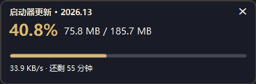

# Stellaris 启动器更新监控

> 让 Paradox / 群星启动器的更新进度可见：更新包大小、百分比、实时速度、剩余时间。




## 为什么需要它

Paradox 启动器（launcher-v2 / Corvus）在更新自己的时候，界面上只有一句「正在下载启动器更新……」，
不显示包大小、进度和速度。而它的 CDN（Fastly）在部分网络环境下只有几十 KB/s，
一个 180 MB 的包要下一个多小时——看起来完全像卡死了。

启动器其实把这些数据都写进了日志，只是不显示。本项目就是把这个日志变成一个小窗：

- 更新包总大小 / 已下载 / 百分比 / 进度条
- 实时速度 + 预计剩余时间
- 下载完成 → 「正在应用补丁 430 / 430…」→「更新已安装 · 重启启动器后生效」
- 游戏 DLC / 内容下载同样会显示（标题变成「内容下载」）
- **启动器打开时小窗自动出现，启动器关闭后自动隐藏**

## 快速开始

1. 下载 [`StellarisUpdateMonitor.exe`](StellarisUpdateMonitor.exe)
2. 双击运行。首次会弹「未知发布者」，点**运行**（exe 没有代码签名，属正常现象）
3. 第一次运行会先显示 8 秒「已开始监视」提示，然后自动隐藏——**这是正常的**，它已经在后台等启动器了
4. 之后每次打开群星启动器，小窗都会自动出现
5. 想开机就自动就绪：双击 `安装到开机自启.cmd`
   （等价于运行 `StellarisUpdateMonitor.exe --install`，会复制到 `%LOCALAPPDATA%\StellarisUpdateMonitor`
   并写入 `HKCU\Software\Microsoft\Windows\CurrentVersion\Run`）
6. 取消开机自启：`取消开机自启.cmd` 或 `StellarisUpdateMonitor.exe --uninstall`

> ⚠️ 这是一个**常驻**工具：必须先运行一次，它才能开始监视。
> 不装开机自启的话，每次重启电脑后需要再双击一次。

## 操作

| 操作 | 效果 |
|---|---|
| 按住小窗拖动 | 移动位置 |
| 点 ✕ | 隐藏本次（启动器下次启动还会出现） |
| 右键 | 刷新 / 隐藏本次 / **退出监控** |
| 再次双击 exe | 叫出后台实例的小窗（不会启动第二个） |

## 从源码编译

只需要 .NET Framework 4.x（Windows 10/11 自带 4.8），不需要 Visual Studio：

```bat
build.cmd
```

等价于：

```bat
csc /target:winexe /codepage:65001 /optimize+ ^
    /r:System.Windows.Forms.dll /r:System.Drawing.dll ^
    src\StellarisUpdateMonitor.cs
```

产物 24 KB，单文件，无任何第三方依赖。

## 命令行参数

```
StellarisUpdateMonitor.exe                常驻，跟随启动器显示 / 隐藏
StellarisUpdateMonitor.exe --show         立即显示，不自动隐藏（调试用）
StellarisUpdateMonitor.exe --install      安装到 LOCALAPPDATA + 开机自启
StellarisUpdateMonitor.exe --uninstall    取消开机自启
StellarisUpdateMonitor.exe --snapshot out.png [--log 日志文件]   渲染界面截图
StellarisUpdateMonitor.exe --state out.txt [--log 日志文件]      输出解析结果
```

## 工作原理

启动器把每次更新的过程写在：

```
%LOCALAPPDATA%\Paradox Interactive\launcher-v2\logs\cpatch*.log
```

里面有这样两行：

```
2026-11-05 21:20:00 [daemon] [DEBUG] 2026.13/-1_to_2026.13/-1_to_2026.13.zip: 151406784 / 194701846 (77%)
2026-11-05 21:20:00 [repository] [DEBUG] Download speed for ...: 41.59 Kb/s
```

程序每秒增量读取日志（只读新追加的字节），并做两件关键过滤：

1. 忽略 `repository.json` / `manifest` / `.asc` 这类元数据文件，它们不是更新包；
2. 忽略打补丁阶段的**单文件进度**——一次更新会为 430 个文件各报一行，
   如果不滤掉，界面会显示成某个 222 MB 文件瞬间 100%。

速度不用日志里的值，而是用两次采样的字节差自己算，更接近真实下载速度。

## 资源占用（Windows 11 / .NET Framework 4.8 实测）

| 状态 | 内存（工作集） | CPU（单核 %） |
|---|---|---|
| 小窗显示中 | ~93 MB | ~0.23% |
| 启动器关闭、仅常驻 | ~93 MB | ~0.05% |

内存主要是 .NET WinForms 的固定开销（一个最小空窗口就要约 78 MB），不是界面内容的开销。

## 常见问题

**双击后什么都没发生？**
首次运行会先显示 8 秒提示再隐藏；如果群星启动器当时没开，之后就没有窗口了——它在后台等着。

**一直显示「等待更新」？**
启动器当前没有在下载东西。打开启动器，等它检查更新。

**卡在 100% 不动？**
正在应用补丁（xdelta 逐文件），几百个文件要一会儿，属正常。

**提示「无法验证发布者」/ 杀软报毒？**
exe 没有代码签名。可以点「仍要运行」，或者按上面的步骤自己从源码编译——代码只有 800 多行，没有网络、注册表之外的可疑行为。

**支持 macOS / Linux 吗？**
不支持。读的是 Windows 路径，界面是 WinForms。

**会影响游戏或启动器吗？**
不会。只读取日志文件，不写、不注入、不改启动器，也不联网。

**启动器更新后还能用吗？**
能。日志格式从 launcher-v2 早期版本至今没变过，程序也不依赖启动器版本。

## 兼容性

- Windows 10 / 11（x64，x86 理论上也可）
- .NET Framework 4.6+（Win10 1607 之后系统自带）
- 高 DPI 缩放会自动跟随系统

## 免责声明

非官方项目，与 Paradox Interactive 无关。仅读取本地日志文件，不上传任何数据。

## License

[MIT](LICENSE)

---

## English

A tiny (24 KB, single-file) Windows widget that shows the **Paradox / Stellaris launcher self-update progress** —
package size, percentage, speed and ETA — which the launcher itself refuses to display.

It tails the launcher's own log at
`%LOCALAPPDATA%\Paradox Interactive\launcher-v2\logs\cpatch*.log`
and pops up an always-on-top window whenever `Paradox Launcher.exe` is running. Read-only: no injection,
no patching, no network access.

**Usage:** run `StellarisUpdateMonitor.exe` once (it stays resident and appears with the launcher),
or run `StellarisUpdateMonitor.exe --install` to start it at login. Windows 10/11 + .NET Framework 4.x.
Build with `build.cmd` (uses the `csc` bundled with .NET Framework). MIT licensed.
